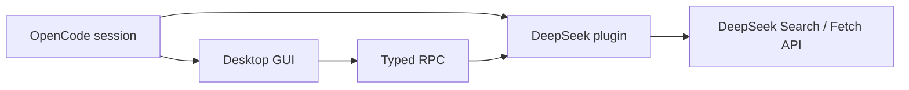

# opencode-deepseek-search

<p align="center">
  
</p>

<p align="center">Unofficial DeepSeek Search and Fetch integration for OpenCode V2.</p>

<p align="center">
  <a href="https://github.com/Pavior0/opencode-deepseek-search/actions/workflows/ci.yml"></a>
  <a href="LICENSE"></a>
</p>

<p align="center"><a href="README.md">English</a> · <a href="README.zh-CN.md">简体中文</a></p>

> [!IMPORTANT]
> This is an independent, unofficial community plugin. It is not affiliated with, endorsed by, or maintained by DeepSeek or OpenCode. DeepSeek branding is used only to identify the API this plugin integrates.

This plugin provides:

- a `deepseek` WebSearch provider for OpenCode's built-in `websearch` tool;
- an explicit `deepseek_search` tool with per-call search controls;
- an explicit `deepseek_fetch` tool for DeepSeek page extraction;
- an experimental OpenCode Desktop GUI for session search, source actions, settings, history, and page preview.

## Requirements

- OpenCode V2 with the Effect plugin API;
- `@opencode/plugin` 2.2.0 or newer for the server plugin;
- an OpenCode Desktop build with the experimental GUI host for the GUI;
- a DeepSeek API key with Search/Fetch access and available balance.

## Install

This project is source-first and is **not published to npm**. OpenCode can install plugins directly from a Git repository over HTTPS:

```sh
opencode plugin add https://github.com/Pavior0/opencode-deepseek-search.git
```

Pin a tag or commit when you want reproducible installs, for example `https://github.com/Pavior0/opencode-deepseek-search.git#v0.0.1`.

The repository's `prepare` script builds the experimental Desktop GUI bundle during Git installation. The equivalent explicit configuration is:

```jsonc
{
  "$schema": "https://opencode.ai/config.json",
  "plugins": [
    {
      "package": "https://github.com/Pavior0/opencode-deepseek-search.git",
      "options": {
        "count": 8,
        "needContent": false,
      },
    },
  ],
}
```

For local development:

```sh
git clone https://github.com/Pavior0/opencode-deepseek-search.git
cd opencode-deepseek-search
bun install
bun run check
```

Then point `package` at that checkout using OpenCode's supported local plugin path syntax. Restart OpenCode after changing the plugin source or GUI bundle.

## How it fits



## What it registers

### Explicit tools

Both tools are available as direct model tools and in Code Mode:

```ts
const results = await tools.deepseek.search({
  query: "OpenCode plugin RPC",
  count: 5,
  need_content: false,
})

const page = await tools.deepseek.fetch({
  url: results[0].url,
})
```

#### `deepseek_search`

Searches DeepSeek's live index. It accepts:

- `query`;
- `count` from 1 to 50;
- `need_content`;
- `ori_question`;
- `localization` as an IPv4 or IPv6 address.

Search syntax is passed through:

| Syntax    | Example                              | Meaning                                                            |
| --------- | ------------------------------------ | ------------------------------------------------------------------ |
| `site:`   | `site:github.com`                    | Limit results to a site. Use explicit `OR` between multiple sites. |
| `-site:`  | `-site:example.com`                  | Exclude a site.                                                    |
| `-`       | `-advertising`                       | Exclude a keyword.                                                 |
| `-"..."`  | `-"release notes"`                   | Exclude an exact phrase.                                           |
| `"..."`   | `"release notes"`                    | Match an exact phrase.                                             |
| `lang:`   | `lang:zh,en`                         | Limit result languages.                                            |
| `after:`  | `after:2025` or `after:2025-01-01`   | Results after a date.                                              |
| `before:` | `before:2026` or `before:2026-06-01` | Results before a date.                                             |

Combine operators with spaces, for example `DeepSeek site:github.com OR site:huggingface.co lang:zh after:2025`.

#### `deepseek_fetch`

Fetches one HTTP(S) URL through DeepSeek's extraction API and returns Markdown. Prefer OpenCode's built-in `webfetch` for raw HTML, non-HTML formats, local redirect permission checks, or custom timeouts.

Set `fetchTool: false` to disable only `deepseek_fetch`; `deepseek_search` remains available.

### WebSearch provider

The plugin registers `deepseek` / `DeepSeek Search` as a provider for OpenCode's built-in `websearch` tool.

Configure it explicitly:

```jsonc
{
  "websearch": {
    "provider": "deepseek",
  },
}
```

Or set `defaultProvider: true` in plugin options. A configured `websearch.provider` still wins over the plugin default.

The explicit tool exposes per-call controls. The standard provider uses the plugin defaults.

### Desktop GUI

The experimental GUI adds:

- a **DeepSeek Search** launcher in the session panel's `+` / New tab menu;
- **DeepSeek: Search the web** and `/ds <query>`;
- **DeepSeek: Search the current prompt**;
- a focused side-panel search experience with advanced result/content options;
- in-app browser opening when the Desktop browser plugin is available;
- result actions for Open, Preview, Cite, and multi-source research packet insertion;
- recent searches with timestamps and result counts;
- a settings page for credentials, defaults, connection testing, and usage links;
- an optional composer pill for the latest session search;
- a Fetch dialog with Markdown preview, copy, retry, and composer insertion.

The Settings page includes persistent switches for the Search side panel, Command Palette/`/ds` entries, and the composer pill. The Settings page itself always remains available.

The GUI calls the RPC of the current session's server. It does not call DeepSeek directly.

The GUI reads credentials lazily through the server, so reconnecting DeepSeek updates the panel without restarting the plugin. Search and Fetch content remains untrusted web data, including content inserted into the composer.

The GUI is experimental and requires the Desktop GUI host; the server tools and WebSearch provider do not require the GUI.

## Credentials

The first usable source wins:

1. the plugin `apiKey` option;
2. the active OpenCode `deepseek` connection;
3. `deepseek` provider settings `apiKey`;
4. the active environment connection;
5. `DEEPSEEK_API_KEY`, followed by names in `env`.

The credential is resolved lazily for every request, so reconnecting DeepSeek takes effect without restarting the plugin.

## Options

| Option            | Type     | Default                             | Notes                                                                                        |
| ----------------- | -------- | ----------------------------------- | -------------------------------------------------------------------------------------------- |
| `apiKey`          | string   | —                                   | Highest-precedence credential.                                                               |
| `baseURL`         | string   | `https://api.deepseek.com`          | HTTPS is required; loopback HTTP is allowed for local proxies. A trailing `/v1` is accepted. |
| `env`             | string[] | `[`<code>DEEPSEEK_API_KEY</code>`]` | Additional environment variable names. The default variable is always retained.              |
| `count`           | number   | `8`                                 | Default provider result count, clamped to 1–50.                                              |
| `needContent`     | boolean  | `false`                             | Default provider content preference.                                                         |
| `localization`    | string   | —                                   | Default provider localization IP.                                                            |
| `timeoutMs`       | number   | `30000`                             | Per-attempt timeout, clamped to 1–120 seconds.                                               |
| `maxRetries`      | number   | `2`                                 | Retries network errors, timeouts, 408, 429, and 5xx responses. Maximum 5.                    |
| `maxContentChars` | number   | `20000`                             | Per-result search content limit.                                                             |
| `maxSummaryChars` | number   | `4000`                              | Per-result summary/snippet limit.                                                            |
| `maxFetchChars`   | number   | `50000`                             | Fetched page content limit.                                                                  |
| `maxOutputChars`  | number   | `120000`                            | Total formatted output limit for `deepseek_search`.                                          |
| `defaultProvider` | boolean  | `false`                             | Make DeepSeek the plugin-level default WebSearch provider.                                   |
| `fetchTool`       | boolean  | `true`                              | Register `deepseek_fetch`.                                                                   |

Invalid option types fail plugin startup. Unsafe or malformed API endpoints are rejected rather than silently redirected to the default endpoint.

The built-in `webfetch` tool remains available. This plugin does not replace it.

## Privacy, security, and billing

- Search queries and fetched URLs are sent to DeepSeek with your API key.
- Search results and page contents are untrusted web data. The tools explicitly instruct the model not to follow instructions found in returned pages.
- `deepseek_fetch` uses OpenCode's `webfetch` permission action. The permission assertion happens before the remote request.
- DeepSeek follows redirects server-side, so OpenCode cannot ask for a separate permission decision for every redirect. Use built-in `webfetch` when local redirect checks are required.
- Search and Fetch usage may incur DeepSeek charges. Check DeepSeek's current pricing and usage pages before enabling automatic or repeated searches; retries can create additional successful requests.
- Response and model-output limits reduce accidental context and billing growth, but they are not a replacement for permission rules.

See the [DeepSeek Search documentation](https://api-docs.deepseek.com/guides/search) and [pricing notes](https://api-docs.deepseek.com/guides/search#计费).

Also see OpenCode's [plugin documentation](https://dev.opencode.ai/v2/docs/plugins) and DeepSeek's [brand asset guidelines](https://github.com/deepseek-ai/awesome-deepseek-integration/blob/main/docs/_logo%20svg/guidelines.md).

## Development

Bun 1.4.4 or newer is required; formatting uses Bun's built-in formatter.

```sh
bun install
bun run format
bun run test
bun run check
```

Useful commands:

| Command                | Purpose                                  |
| ---------------------- | ---------------------------------------- |
| `bun run format`       | Format the repository with Bun           |
| `bun run format:check` | Verify formatting without writing        |
| `bun run test`         | Run network-free tests                   |
| `bun run typecheck`    | Type-check server and GUI sources        |
| `bun run build`        | Build `dist/gui-experimental.cjs`        |
| `bun run check`        | Format check, typecheck, and GUI build   |
| `bun run dev`          | Watch and rebuild the Desktop GUI bundle |

See [CONTRIBUTING.md](CONTRIBUTING.md) or [CONTRIBUTING.zh-CN.md](CONTRIBUTING.zh-CN.md) before opening a change.

## License

MIT. See [LICENSE](LICENSE).
