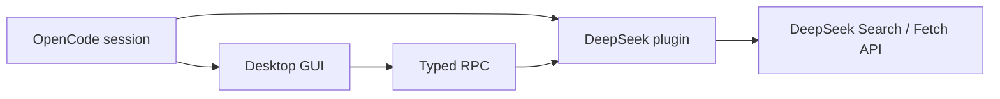

# opencode-deepseek-search

<p align="center">面向 OpenCode V2 的非官方 DeepSeek Search 和 Fetch 集成。</p>

<p align="center">
  <a href="https://github.com/Pavior0/opencode-deepseek-search/actions/workflows/ci.yml"></a>
  <a href="LICENSE"></a>
</p>

<p align="center"><a href="README.md">English</a> · 简体中文</p>

> [!IMPORTANT]
> 这是独立的非官方社区插件，与 DeepSeek 或 OpenCode 没有隶属、维护或背书关系。“DeepSeek”仅用于标识实际接入的 API。

插件提供：

- `deepseek` WebSearch provider，接入 OpenCode 内置 `websearch`；
- 显式 `deepseek_search` 搜索工具；
- 显式 `deepseek_fetch` 页面抽取工具；
- 实验性的 OpenCode Desktop GUI，包括会话搜索、来源操作、设置、历史和页面预览。

## 要求

- 支持 Effect plugin API 的 OpenCode V2；
- server plugin 需要 `@opencode/plugin` 2.2.0 或更新版本；
- GUI 需要包含 experimental GUI host 的 OpenCode Desktop；
- 拥有 Search/Fetch 权限且余额充足的 DeepSeek API key。

## 安装

本项目以源码为主，**不会发布到 npm**。OpenCode 支持通过 HTTPS Git 地址直接安装插件。

本项目以源码为主，**不会发布到 npm**。OpenCode 支持通过 HTTPS Git 地址直接安装插件：

```sh
opencode plugin add https://github.com/Pavior0/opencode-deepseek-search.git
```

需要可复现的安装时，可以固定 tag 或 commit，例如 `https://github.com/Pavior0/opencode-deepseek-search.git#v0.0.1`。

Git 安装时会通过仓库的 `prepare` 脚本构建实验性 Desktop GUI bundle。等价的显式配置如下：

```jsonc
{
  "$schema": "https://opencode.ai/config.json",
  "plugins": [
    {
      "package": "https://github.com/Pavior0/opencode-deepseek-search.git",
      "options": {
        "count": 8,
        "needContent": false,
      },
    },
  ],
}
```

本地开发：

```sh
git clone https://github.com/Pavior0/opencode-deepseek-search.git
cd opencode-deepseek-search
bun install
bun run check
```

然后使用 OpenCode 支持的本地 plugin path 语法，将 `package` 指向这个 checkout。修改 plugin source 或 GUI bundle 后重启 OpenCode。

## 工作方式



## 注册的能力

### 显式工具

两个工具都支持普通 tool call 和 Code Mode：

```ts
const results = await tools.deepseek.search({
  query: "OpenCode plugin RPC",
  count: 5,
  need_content: false,
})

const page = await tools.deepseek.fetch({
  url: results[0].url,
})
```

#### `deepseek_search`

显式调用 DeepSeek Search，支持：

- `query`；
- 1–50 的 `count`；
- `need_content`；
- `ori_question`；
- IPv4/IPv6 格式的 `localization`。

搜索语法会原样传递给 DeepSeek：

| 语法      | 示例                                 | 含义                                  |
| --------- | ------------------------------------ | ------------------------------------- |
| `site:`   | `site:github.com`                    | 限定站点。多个站点需要显式使用 `OR`。 |
| `-site:`  | `-site:example.com`                  | 排除站点。                            |
| `-`       | `-广告`                              | 排除关键词。                          |
| `-"..."`  | `-"release notes"`                   | 排除精确短语。                        |
| `"..."`   | `"release notes"`                    | 精确匹配短语。                        |
| `lang:`   | `lang:zh,en`                         | 限定结果语言。                        |
| `after:`  | `after:2025` 或 `after:2025-01-01`   | 限定发布日期晚于指定日期。            |
| `before:` | `before:2026` 或 `before:2026-06-01` | 限定发布日期早于指定日期。            |

多个操作符用空格组合，例如 `DeepSeek site:github.com OR site:huggingface.co lang:zh after:2025`。

#### `deepseek_fetch`

通过 DeepSeek Fetch API 抽取一个 HTTP(S) 页面并返回 Markdown。对于原始 HTML、非 HTML 格式、本地 redirect 权限检查或自定义超时，应优先使用 OpenCode 内置 `webfetch`。

设置 `fetchTool: false` 只会关闭 `deepseek_fetch`，不会关闭 `deepseek_search`。

### WebSearch provider

插件注册：

```text
providerID: deepseek
name: DeepSeek Search
```

因此 OpenCode 内置 `websearch` 可以使用 DeepSeek：

```jsonc
{
  "websearch": {
    "provider": "deepseek",
  },
}
```

也可以设置插件选项 `defaultProvider: true`。如果已经配置 `websearch.provider`，显式配置仍然优先。

显式 `deepseek_search` 支持单次调用控制；标准 `websearch` 使用插件默认值。

### Desktop GUI

实验性 GUI 提供：

- 当前 session 侧栏 `+` / New tab 菜单中的 **DeepSeek 搜索**入口；
- **DeepSeek: Search the web** 和 `/ds <query>`；
- **DeepSeek: Search the current prompt**；
- 带高级搜索选项的紧凑侧边搜索面板；
- Desktop Browser plugin 可用时优先在应用内打开来源；
- Open、Preview、Cite，以及多来源 research packet 插入；
- 显示日期时间和结果数量的最近搜索；
- 连接、默认行为、测试和用量链接设置页；
- 可选的当前 session composer pill；
- 支持 Markdown 预览、复制、重试和插入 composer 的 Fetch dialog。

设置页提供持久化开关，用于控制搜索侧边面板、命令面板/`/ds` 入口和 composer pill；设置页本身始终保留。

GUI 不直接请求 DeepSeek，而是调用当前 session 对应 server 的 RPC。

GUI 每次请求都会通过 server lazy resolve credential，因此重新连接 DeepSeek 后无需重启插件。搜索结果和页面正文始终是不可信网页内容，包括插入 composer 的内容。

GUI 是实验性能力，需要 Desktop GUI host；server tools 和 WebSearch provider 不依赖 GUI。

## Credential 优先级

第一个可用来源生效：

1. plugin `apiKey`；
2. OpenCode 当前激活的 `deepseek` connection；
3. `deepseek` provider settings 中的 `apiKey`；
4. 当前环境 connection；
5. `DEEPSEEK_API_KEY`，以及 `env` 中配置的变量。

每次请求都会 lazy resolve credential，因此重新连接 DeepSeek 后无需重启插件。

## Options

| Option            | 类型     | 默认值                              | 说明                                                          |
| ----------------- | -------- | ----------------------------------- | ------------------------------------------------------------- |
| `apiKey`          | string   | —                                   | 最高优先级 credential。                                       |
| `baseURL`         | string   | `https://api.deepseek.com`          | 必须 HTTPS；本地 proxy 可使用 loopback HTTP；接受结尾 `/v1`。 |
| `env`             | string[] | `[`<code>DEEPSEEK_API_KEY</code>`]` | 额外环境变量名，默认变量始终保留。                            |
| `count`           | number   | `8`                                 | provider 默认结果数，限制在 1–50。                            |
| `needContent`     | boolean  | `false`                             | provider 默认是否请求页面内容。                               |
| `localization`    | string   | —                                   | provider 默认地区 IP。                                        |
| `timeoutMs`       | number   | `30000`                             | 单次 attempt 超时，限制在 1–120 秒。                          |
| `maxRetries`      | number   | `2`                                 | 重试网络错误、超时、408、429 和 5xx，最多 5 次。              |
| `maxContentChars` | number   | `20000`                             | 每条搜索结果的正文上限。                                      |
| `maxSummaryChars` | number   | `4000`                              | 每条搜索结果的 summary/snippet 上限。                         |
| `maxFetchChars`   | number   | `50000`                             | Fetch 页面正文上限。                                          |
| `maxOutputChars`  | number   | `120000`                            | `deepseek_search` 格式化输出总上限。                          |
| `defaultProvider` | boolean  | `false`                             | 将 DeepSeek 设为 plugin-level 默认 WebSearch provider。       |
| `fetchTool`       | boolean  | `true`                              | 是否注册 `deepseek_fetch`。                                   |

非法 option 类型会导致插件启动失败。危险或非法 API endpoint 会被拒绝，不会静默回退到默认地址。

插件不会替换 OpenCode 内置 `webfetch`，两者可以同时使用。

## 隐私、安全与计费

- 搜索 query 和 Fetch URL 会携带 API key 发送给 DeepSeek；
- 搜索结果和页面内容都属于不可信网页数据，工具会明确提示模型不要执行其中的指令；
- `deepseek_fetch` 使用 OpenCode 的 `webfetch` permission action，并在远程请求前执行 permission assertion；
- redirect 由 DeepSeek 服务端处理，OpenCode 无法针对每次 redirect 单独询问权限；
- Search 和 Fetch 可能产生 DeepSeek 费用。启用自动或重复搜索前，请查看 DeepSeek 当前价格和用量页面；重试可能产生额外的成功请求；
- response 和模型输出上限可以减少意外的上下文和费用增长，但不能替代 permission 规则。

参考：[DeepSeek Search 文档](https://api-docs.deepseek.com/guides/search) · [计费说明](https://api-docs.deepseek.com/guides/search#计费)

另请参阅 OpenCode 的 [plugin 文档](https://dev.opencode.ai/v2/docs/plugins)。

## 开发

需要 Bun 1.4.4 或更新版本，格式化使用 Bun 内置的格式化器。

```sh
bun install
bun run format
bun run test
bun run check
```

常用命令：

| 命令                   | 用途                             |
| ---------------------- | -------------------------------- |
| `bun run format`       | 使用 Bun 格式化整个仓库          |
| `bun run format:check` | 检查格式但不写文件               |
| `bun run test`         | 执行不访问网络的测试             |
| `bun run typecheck`    | 检查 server 和 GUI 类型          |
| `bun run build`        | 构建 `dist/gui-experimental.cjs` |
| `bun run check`        | 格式检查、类型检查和 GUI 构建    |
| `bun run dev`          | watch 并重建 Desktop GUI bundle  |

提交改动前请阅读 [CONTRIBUTING.md](CONTRIBUTING.md) 或 [CONTRIBUTING.zh-CN.md](CONTRIBUTING.zh-CN.md)。

## License

MIT，见 [LICENSE](LICENSE)。
